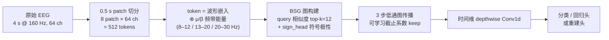

<div align="center">

# bci-foundation-model

**A lightweight EEG encoder that treats electrode layout as a graph, not as a fixed channel vector.**

轻量脑电基础模型：用平衡符号图（BSG）展开替代注意力，在 **1.39M 参数**内完成 64 通道 MI/ME 建模与通道-时间掩码预训练。

[](#快速开始--quick-start)
[](#快速开始--quick-start)
[](#模型设计--design)
[](#当前状态--status)

</div>

---

## 项目简介 / Overview

主流脑电基础模型动辄数十亿参数，但脑电数据量远小于自然语言，参数预算与数据规模常常错配。本项目走相反方向：**在 5M 参数硬预算内，用归纳偏置换掉一部分参数**。

具体选择是把电极空间关系直接编码进计算图——用图的低通传播替代 self-attention 的全局两两交互。这样做的代价是失去任意长程依赖，收益是参数效率与对电极拓扑的显式建模，且缺失通道可在结构层面处理，而不是靠零填充。

> A sub-5M-parameter EEG encoder that replaces multi-head attention with balanced signed graph unrolling. Electrode topology is encoded as a sparse signed graph; channel-level masking gives native robustness to missing electrodes.

---

## 模型设计 / Design



| 设计点 | 实现 | 为什么 |
|---|---|---|
| **patch 划分** | 0.5 s / patch，8 patch × 64 通道 = 512 tokens | 与运动想象的 2 s 决策窗兼容，同时控制序列长度 |
| **token 构造** | 波形嵌入 + 固定 μ/β 频带能量（8–12、13–20、20–30 Hz） | MI/ME 的 ERD/ERS 生理机制正落在 μ/β 频段，显式给出比让网络自己学更省样本 |
| **图构建** | query 相似度取 top-k=12 建稀疏图 + softmax 归一化 | 稀疏化后传播代价与通道数近线性，避免 O(N²) |
| **符号极性** | `sign_head` 输出边权正负 | 脑区之间既存在同步也存在反相，只用非负权重会丢失抑制关系 |
| **图传播** | 3 步低通滤波，`keep` 为可学习截止系数 | 低通等价于局部平滑，3 步即覆盖相邻脑区；`keep` 让模型自行决定平滑强度 |
| **时间建模** | depthwise Conv1d | 时间维度用卷积比注意力更省参数，且保持因果可控 |
| **参数量** | **1,393,642**（含全部头） | 严格控制在 5M 预算内，留出预训练与多任务扩展空间 |

代码入口：[`src/eeg_mime_foundation/model.py`](src/eeg_mime_foundation/model.py)。

---

## 预训练目标 / Pretraining

**通道-时间联合掩码重建（masked channel-time reconstruction）+ 频谱约束**：

- 随机掩码 **55%** 的 token，要求模型重建被遮信号——脑电在时间与通道上都有强冗余，高掩码率才能逼出非平凡表征；
- 重建损失之外加频带能量约束，防止模型只拟合波形细节而丢掉频段功率结构；
- **`channel_mask` 是原生机制**：训练时按通道整列掩码，推理时可直接丢弃任意电极子集，无需重训。

```bash
# 掩码预训练 → 下游微调 → 评估
python -m eeg_mime_foundation.cli train --config configs/fusion_masked.json \
    --manifest data/processed/diagnostic/manifest.json --output experiments/outputs/masked
python -m eeg_mime_foundation.cli train --config configs/fusion_supervised.json \
    --manifest data/processed/diagnostic/manifest.json \
    --initialize experiments/outputs/masked/best.pt --output experiments/outputs/finetuned
python -m eeg_mime_foundation.cli evaluate --checkpoint experiments/outputs/finetuned/best.pt \
    --manifest data/processed/diagnostic/manifest.json --split validation \
    --output experiments/outputs/finetuned-validation
```

---

## 实验结果 / Results

在 **69 个已核验源码与检查点的真实数据运行**上（运动想象 + 睡眠，各扩展到 10 名被试）：

| 任务 | 训练方式 | Balanced Accuracy |
|---|---|---|
| 运动想象（MI） | 直接训练 | **51.72%** |
| 运动想象（MI） | 掩码预训练 + 全量微调 | 51.37% |
| 睡眠分期 | 直接训练 | **67.17%** |
| 睡眠分期 | 掩码预训练 + 全量微调 | 69.18% |

同一联合预训练基座完成了两个任务的 full / linear 迁移。

### 结论边界（重要）

**代码可运行，不等于"基础模型优于从头训练"。** 上表说明的是：

- 轻量编码器在两个任务上都**可训练、可迁移**，联合预训练基座可以同时支撑 MI 与睡眠；
- 掩码预训练在 MI 上**没有**带来稳定增益（51.37% vs 51.72%），在睡眠上有小幅提升但尚未做被试级显著性检验；
- 因此当前**不声称**通用基础模型收益成立。这类结论需要固定划分下的配对 bootstrap，而不是单点比较。

---

## 当前状态 / Status

项目处于**预训练准备阶段**，遵循"未跑通 sanity model 不启动正式预训练"的门禁：

- [x] 编码器与预训练目标实现，参数量核验 1.39M
- [x] 数据账本（NPZ/JSON manifest、真实通道身份、哈希、分组审计）
- [x] 真实数据小规模验证（MI / 睡眠，各 10 被试）
- [ ] 正式预训练（等待数据规模与清洗协议确认）
- [ ] 跨设备迁移评测（可变电极布局）

> 仓库不包含原始数据与检查点。`data/` 仅保留账本格式说明，真实数据按 [`data/README.md`](data/README.md) 的限定导入流程本地准备。

---

## 快速开始 / Quick Start

```bash
py -3.12 -m pip install -e . --no-deps --no-build-isolation
py -3.12 -X utf8 -m unittest discover -s tests -v

# 合成数据烟雾测试（只验证接口，不用于任何方案选择）
py -3.12 -X utf8 -m eeg_mime_foundation.cli smoke --output experiments/outputs/my-smoke
```

每个实验使用**新目录**，避免覆盖历史证据。

---

## 目录结构 / Layout

```
bci-foundation-model/
├── src/eeg_mime_foundation/   # 编码器、预训练、训练循环、CLI
├── configs/                   # 配方：fusion_masked / fusion_supervised / recipes
├── scripts/                   # 真实数据准备、验证、蒸馏、few-shot、报告
├── docs/                      # 架构、路线图、协议、赛前设计
├── reports/                   # 验收记录（真实数据闭环、工程验收）
├── tests/                     # 单元测试
└── experiments/ results/      # 本地输出（不入库）
```

## 文档 / Docs

- [`docs/architecture.md`](docs/architecture.md) — 编码器与数据流
- [`docs/roadmap.md`](docs/roadmap.md) — 阶段划分与门禁条件
- [`docs/5M_MI_ME模型改造方案.md`](docs/5M_MI_ME模型改造方案.md) — 参数预算与模块取舍
- [`docs/基础模型直接验证协议.md`](docs/基础模型直接验证协议.md) — 当前研发入口
- [`docs/训练前问题清单.md`](docs/训练前问题清单.md) — 启动正式预训练前的 10 项检查
- [`docs/联合预训练与共享基座规范.md`](docs/联合预训练与共享基座规范.md) — MI + 睡眠共享基座

## 在项目群中的位置

训练与评测协议复用 [bci-bench](https://github.com/periodgod/bci-bench) 的数据契约、划分与指标定义；下游系统见 [bci-arm-robot](https://github.com/periodgod/bci-arm-robot) 与 [bci-visual-app](https://github.com/periodgod/bci-visual-app)。

---

<div align="center"><sub>Wuyi University · BCI Group　|　数据与权重不随仓库分发</sub></div>
