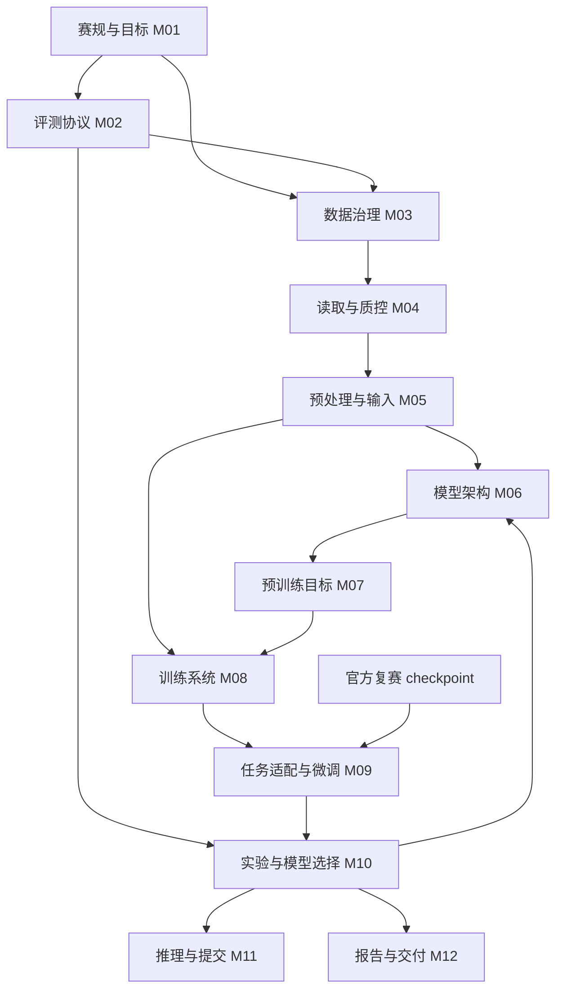

# OmniEEG 基础模型全流程设计与启动方案

日期：2026-10-09。

状态：技术设计与工作拆分，等待正式赛规和 starting kit 校准。本文搭建的是研发流程和模块边界；尚未实现数据管线、训练器或比赛提交接口，也未启动训练。

## 1. 先确定我们要完成什么

目标是训练或适配一个共享 EEG 编码器，验证它在不同被试、设备和任务上的迁移能力，并按 OmniEEG 官方协议完成评测。模型的价值由下游泛化和适配效率证明，参数量和重建 loss 只是辅助信息。

总体分两条路线：

- 比赛路线：按阶段要求，先完成官方基础模型微调评测，再开展规定数据上的从零预训练。
- 内部验证路线：使用已有 MI/ME、纯 MI、SSVEP 和情绪项目，诊断信号、验证工程和迁移方法。内部结果不能替代官方成绩。

通用系统以共享编码器为中心；MI/ME 的 mu/beta 先验、层级标签和机器人控制属于任务层，不固定进所有任务的编码器。

## 2. 海报提供的事实与尚未明确的规则

| 项目 | 海报信息 | 对设计的影响 |
| --- | --- | --- |
| 赛事 | OmniEEG Challenge，2026 非侵入式脑机接口 EEG 基础模型算法竞赛 | 需要基础表征与多任务迁移，而非单个八分类器 |
| 主办 | 南方科技大学、河套学院、腾讯云 | 具体技术要求以正式规则为准 |
| 赛道 | 信号可靠性、疾病诊断、睡眠分期、认知情绪、运动想象、自然刺激解码、SSVEP；总赛道为七赛道综合评分 | 数据时长、频带、标签单位和评分不同 |
| 评测 | OmniEEG-Bench 统一评测，海报写 cross-subject 8:1:1 划分 | 优先对齐被试切分和官方评测入口 |
| Proposal | 2026-11-02 开始；10 页 PPT、2 页 Proposal、1 页算力预算；约 2 周及评审 1 周 | 先建立可论证方案与实测资源预算 |
| 微调复赛 | 官方数据与 EEG 基础模型微调，统一环境，约 2 周及评审 1 周 | 先解决 checkpoint、输入和微调协议 |
| 预训练决赛 | OpenNeuro 21 个数据集，从零预训练，不使用任何公开权重；约 2 周 | 预训练必须有完整数据与恢复训练闭环 |
| 算力 | 复赛与决赛提供 GPU；海报写完整赛程约 8 周 | 分阶段时间为约数，可用 GPU 小时需以官方资源说明确定 |
| 报名 | 10-09 至 10-31；最多 160 队、每队 2-3 人；奖金池 20 万元 | 当前处于报名起始日 |

必须从官方规则获取：21 个数据集名单与版本、七赛道具体任务、评分权重与归一化、允许的数据和权重、预训练能否接触下游测试被试、8:1:1 的具体被试名单、验证标签开放范围、输入输出格式、微调预算、提交次数、GPU 型号/数量/时长。

海报中的宣传性表述不能当作工程保证。以上信息仅来自附件，尚未通过官方说明交叉核验。

## 3. 我们目前真正拥有的资产

### 3.1 基础模型项目

- 已有 `BalancedSignedGraphMIME` 原型，实测参数为 1,393,642。
- 输入固定为 4 秒、160 Hz、最多 64 通道；0.5 秒 patch，宽度 192，6 个图传播块。
- 已有 raw waveform 与 mu/beta bandpower 融合、重建头、MI/ME 状态头、部位头、八分类头。
- 项目尚无真实数据账本、loader、预训练 runner、微调 runner、checkpoint 或训练结果表。
- 配置写有 raw/spectral/bandpower 混合损失，但代码中的 `reconstruction_loss` 目前只有 raw MSE。
- README 的当前 1.4M MI/ME 决策与旧文档的 10M 通用 Transformer 决策并存。实施新路线时应统一正式规格并删除过时运行配置，不能让两套说明同时指挥训练。

因此目前是有设计与模型骨架，尚未证明预训练有效。

### 3.2 相关项目的实际结果

| 资产 | 已保存结果 | 能说明什么 |
| --- | --- | --- |
| LJY MI/ME 八分类 | A case 五 seed BA 24.74% ± 2.27 个百分点；C case 26.03% ± 1.99 个百分点；八分类均匀随机参考 12.5% | 有可分信息，但精度仍有限，且属于现有交叉验证口径 |
| LJY 分解任务 | A case：MI/ME 状态 BA 64.08%，身体部位 BA 42.11%，纯 MI 四部位 BA 40.15% | 状态和部位有信息，八分类难度不能简单归结为完全没有信号 |
| ZLC MI/ME 八分类 | 单次 vote-capsule BA 42.5%；其他两个投票模型五 seed 均值约 36.7% 和 36.5% | 被试/采集差异值得关注；不同模型的单次最好值与多 seed 均值不能直接比较 |
| 纯 MI 左右手 | 07-25 比较报告：20 trial，最好 CV accuracy 85%；07-26 另一报告：20 窗口，CV 60%；独立记录测试报告：20 窗口，accuracy 35% | 样本很少、实验与模型不同，不能直接作差；尚未证明跨记录可靠性 |
| 情绪 EEG+fNIRS | no-prior 直接信号 MAE 47.0764，中心预测 47.5663；含强先验方案 MAE 28.6868 | 先验增益不能当作 EEG 编码器的表征增益，fNIRS 成绩不能直接迁移为纯 EEG 成绩 |
| 共享工具 | `wyu-bci-bench` 有读取、质控、滤波、标签分解、传统模型与指标汇总 | 应复用已有能力，并补齐分组评估 |
| 本机 | RTX 4060 Laptop，约 8 GB 显存；可用 PyTorch 2.6.0+cu124 环境 | 可以做小模型闭环和资源剖析，完整决赛预算依赖官方 GPU |

现有 bench 的 `stratified_folds` 按样本标签随机分层，没有接收 subject/session/trial groups。它不能直接实现官方跨被试评估；有同 trial 多窗口时，还必须禁止这些窗口跨折。

已有名为 `fbcsp-lda` 的 bench 基线实质为滤波器组空间 log-variance 加 diagonal LDA，没有学习标准 CSP 投影。报告中应准确命名，真正 FBCSP 对照应优先使用成熟实现。

### 3.3 正式训练前必须处理的代码风险

| 问题 | 核查证据 | 影响与处理 |
| --- | --- | --- |
| masked pooling 少除时间片数 | 全 1 特征不传 mask 得 1，传全有效 mask 得 8 | 同一信号表示因 mask 路径被放大 8 倍；按有效 channel-time token 数归一化 |
| 全无效通道仍进行图传播 | 全 false mask 的图滤波输出 max abs 约 1.455 | 全被屏蔽行 softmax 产生均匀权重；拒绝全无效输入，无效节点不参与传播 |
| 通道 ID 实际按数组位置取 embedding | `channel_embedding[:, :channels]` | 相同位置的电极可能不同；必须传真实电极身份或坐标，不能把 32 路直接当 64 路前半段 |
| patch mask 覆盖了位置编码 | 先加位置再用 mask token 替换 | 被遮蔽位置失去显式电极/时间身份；先替换内容，再添加位置编码 |
| 图边权温度过低 | 归一化向量点积后再除 sqrt(192) | logits 在约 [-0.072, 0.072]，保留边权容易接近均匀；通过边权分布与消融验证温度 |
| signed graph 理论尚未对齐 | `tanh` 极性左右各乘一次，top-k 邻接未保证对称 | 连续极性不是可逆的 ±1 符号变换；当前实现不能直接宣称复现论文的平衡性或滤波保证 |

本轮只分析，没有修改这些模型行为。随机输入前向通过不代表模型已经学会 EEG。

## 4. 完整工作拆分：12 个模块

每个模块负责一类决策与产物。它们有依赖关系，不等于 12 个必须依次完成的阶段，也不要求 12 人团队。

| 模块 | 工作内容 | 输入 | 必须产出 | 验收条件 |
| --- | --- | --- | --- | --- |
| M01 目标与赛规 | 阶段要求、任务定义、评分、数据/权重权限 | 正式赛规、starting kit | 规则矩阵、任务清单、待确认项 | 每条设计可追溯到规则或实验假设 |
| M02 评测协议 | 被试/会话切分、指标、few-shot、测试封存 | 官方 split 与标签协议 | 固定 split、任务指标函数、泄漏检查 | 同一 split 可复现，相关 trial 不跨集合 |
| M03 数据治理 | 数据清单、许可、版本、重复与被试匹配 | 官方/公开/自采数据 | manifest、校验和、排除清单、数据卡 | 每样本可追溯，预训练与测试关系明确 |
| M04 读取与质控 | 读取原始格式、事件对齐、坏道/坏段、单位 | 原始记录与事件 | reader、QC 报告、可信索引 | 时轴和单位正确，可解释拒绝的样本 |
| M05 预处理与输入 | 参考、重采样、频带、切窗、坐标、padding | QC 通过记录、任务规格 | 版本化输入协议、缓存、batch collator | 时频内容保留，通道/时间 mask 正确 |
| M06 模型架构 | tokenizer、位置、共享编码器、pooling、输出 | 输入协议、算力边界 | 单一主模型、参数/FLOPs/显存报告 | 前反向、缺失通道和长度变化契约通过 |
| M07 预训练目标 | 掩码、重建目标、损失、增强 | 编码器与训练样本 | objective、mask sampler、损失诊断 | 无目标泄漏，优于简单重建基线 |
| M08 训练系统 | 优化器、AMP、采样、保存恢复、吞吐 | 模型、objective、数据 split | train runner、checkpoint、预算记录 | 恢复后训练可继续，记录完整且无 NaN |
| M09 任务适配与微调 | 官方权重加载、任务头、冻结/解冻、少样本 | checkpoint、下游训练集 | finetune runner、任务模型、适配曲线 | 所有策略相同 split/预算，无测试调参 |
| M10 实验与选择 | 强基线、scratch 对照、消融、多 seed | M02 与训练/微调输出 | 结果长表、配对比较、模型选择记录 | 改进能归因，不靠一次最好值 |
| M11 推理与提交 | 预处理一致性、长记录聚合、依赖、官方接口 | 选定模型与官方格式 | 推理包、提交文件、复现命令 | 干净环境通过官方检查，时限内完成 |
| M12 报告与交付 | Proposal、预算、模型卡、失败分析 | 上述证据和记录 | PPT、Proposal、算力预算、复现报告 | 所有结论对应真实结果、限制明确 |

共同主线：



## 5. 数据系统：先解决数据身份，再做统一张量

### 5.1 三种数据角色

- 预训练数据：只用于规定范围内的表征学习；记录来源、有效时长与采样权重。
- 模型选择数据：用于早停、超参数、微调策略和架构选择。
- 最终测试数据：不参与模型选择；是否允许无标签接触由官方规则决定并明确记录。

预训练阶段接触下游测试被试、无标签对齐或测试时自适应都不能默认为允许。若官方允许，应与完全隔离的实验分开报告。

### 5.2 最小样本契约

```text
eeg: float32 [C, T]
sampling_rate_hz, unit, channel_names, channel_positions
dataset_id, subject_id, session_id, recording_id, trial_id
start_sample, end_sample, source_path, checksum
task_id, label, label_unit, split, quality_flags
preprocessing_version
```

非标准电极没有坐标时记录已知身份和缺失状态，不能猜测位置。禁止把 `EEG 1_1` 等设备占位名称直接当作 C3/C4；必须核对采集配置中的实际电极映射。

先按 subject/session/recording 定义 split，再切窗口和生成缓存。缓存键包含数据校验和、预处理版本和参数，防止旧缓存混入新实验。

### 5.3 多任务需要不同预处理协议

| 任务 | 输入与标签特点 | 特别约束 |
| --- | --- | --- |
| MI | 秒级 trial、感觉运动节律 | 保留事件后的有效运动想象段；CSP/协方差需要明确参考和频带 |
| SSVEP | 频率、谐波和相位信息 | 不能全局固定 45 Hz 低通而丢掉所需谐波；不做改变类别语义的频率增强 |
| 睡眠 | 常见为 30 秒 epoch，具体遵从官方 | 保留慢波、纺锤等信息；长时上下文在任务层处理 |
| 疾病诊断 | 标签可能属于整段记录或被试 | 先聚合窗口，再以记录/被试计分，不能把相关窗口当独立病人 |
| 认知情绪 | 标签可能为分类或连续值 | 禁止把刺激身份和时序先验混作 EEG 表征提升 |
| 自然刺激解码 | 输入与目标严格时间对齐 | 按刺激/记录分组，保留官方要求的延迟与分辨率 |
| 信号可靠性 | 质量或可靠性标签 | 质控不能提前删掉该赛道需要模型识别的低质量样本 |

推荐通用输入的初始候选为 256 Hz、0.5 秒 patch。256 Hz 是工程候选，不是比赛要求：必须先检查全部任务的最高有效频率，并在建缓存前冻结。若任务需要超过其 Nyquist 频率的内容，需重新确定正式采样率。

MI 第一轮可先对现有 160 Hz 原型做控制实验；新共享模型使用自己的单一输入协议，不通过兼容分支混用旧输入。第一版不把所有数据都固定成 4 秒：MI 可为 4 秒，睡眠按官方 epoch，任务时长可变，padding 用 mask 排除。

通用自监督训练不对每个片段任意缩放到完全相同的幅度，以免抹掉可靠性/疾病任务需要的幅度信息。单位、裁剪和归一化策略必须可复现；任何拟合统计量只用被允许的训练数据。

## 6. 模型系统：一个共享编码器，独立目标与任务头

### 6.1 推荐结构

```text
EEG + 电极身份/坐标 + 时间信息 + 有效性 mask
    -> 每通道时域 patch tokenizer
    -> 添加电极与时间编码
    -> 共享时空编码器
    -> channel-time features
         -> 预训练重建 decoder（只在预训练使用）
         -> masked pooling -> 分类/回归头
         -> 时间序列特征 -> 分期/序列解码头
         -> 多窗口特征 -> 记录/被试聚合头
```

接口约定：`encoder` 返回 `[B, C, P, D]` 特征与有效性 mask；预训练 decoder 和各任务 head 独立调用，不在一次普通推理中固定计算三个 MI/ME logits 和重建波形。

### 6.2 主干选择

第一轮建议采用标准时空分解 Transformer 作为可解释的参考编码器：在 patch 时间轴和通道轴分别使用成熟 PyTorch attention 模块。初始候选宽度 128、深度 4，参数与显存以实际实现测量为准。

选择依据是标准算子、明确的 mask 语义和容易控制的计算成本。它是否优于图模型必须由同协议实验决定。电极/时间编码同样可以提供空间结构，不能把普通 Transformer 描述为必然不知道电极位置。

现有 BSG 原型作为候选对照，在修复 M06 的问题后测试。只有当它在相同数据、训练预算与下游协议下有可复现收益，才选择为正式主干。正式路线确定后保留必要的实验对照，不维护历史运行兼容层。

对 `C` 通道、`P` 时间片，全局 attention 的注意力矩阵规模为 `(CP)^2`；时空分解约为 `PC^2 + CP^2`。例如 64 通道、30 秒、0.5 秒 patch 时，P=60，矩阵元素约从 14,745,600 降到 476,160。该比值只对应注意力矩阵，不等于整体加速或显存缩减比。

### 6.3 泛化契约

- 电极编码以实际身份或坐标为输入，不能依赖数组序号。
- 时间编码支持不同 P，不能仅有固定 8 个位置。
- 内容先 mask，再加位置；缺失通道 mask 与预训练 mask 分开。
- 批处理 padding 不参与 attention、损失或 pooling。
- 通道重排且身份同步重排后，聚合表征应保持一致；未知通道身份应报错或按明确定义处理，不能静默冒充标准电极。
- mu/beta bandpower 先作为 MI 分支或消融，不默认成为所有任务唯一频率先验。
- 当前采用轻量编码器不构成永久 5M 上限；是否扩大模型由数据多样性、资源和迁移结果决定。

## 7. 预训练目标与训练系统

### 7.1 从一个可诊断目标开始

第一轮只使用 masked channel-time reconstruction：默认随机 mask 50%，具体比例在验证集确定；目标只计算被遮蔽且有效的 patch。

第一轮先用 raw MSE 建立完整闭环，检查单位和目标尺度；接着用一个单独消融增加 log-spectrum 损失。两者不应在没有对照时同时引入。mu/beta bandpower 损失只在 MI 专项消融中评估。

不默认加入 VQ tokenizer、teacher distillation、对比损失、域对抗和多任务监督。只有第一轮指标暴露明确问题，且新增目标可以解释其作用时才增加。决赛从零预训练不得使用公开教师权重。

必须检查零值/均值重建基线、频谱恢复、held-out subject 的重建和 frozen probe。raw MSE 下降可能来自学习平滑波形或伪迹，不能单独作为 checkpoint 优劣结论。

### 7.2 增强和采样

第一版可尝试通道 dropout、有限幅度扰动、低幅噪声；增强范围要由数据尺度和任务语义确定。SSVEP 不任意扭曲时间，MI 不将左右电极交换却保留原标签。

多数据集训练先按 dataset 和 subject 分层采样，避免时长最大的记录支配训练。先采用一个明确的平衡规则，记录每个数据集实际看过的时长，不先搜索大量采样指数。

### 7.3 训练器的必要能力

- 固定种子、配置快照、代码版本、数据 manifest/split 哈希。
- AdamW、warmup、学习率调度、验证、梯度裁剪和硬件支持的 AMP。
- 保存 model、optimizer、scheduler、scaler、step、随机状态；恢复训练后检查参数和学习率连续性。
- 保存 last 与验证选择的 best checkpoint，记录选择依据。
- 记录 loss 分项、吞吐、加载耗时、峰值显存、已见数据量和 GPU 小时。
- 本机单 GPU 闭环先完成；仅在官方资源需要多 GPU 时实现 DDP，不先搭分布式平台。

起始 batch 不预先承诺，先用真实通道数和最长输入做 profile。梯度累积改善有效 batch，不减少每个 microbatch 的峰值激活内存。

算力预算按 `总优化步数 × 实测每步秒数 / 3600 × GPU 数` 估算，并另计评估、缓存构建、恢复和必要重跑。不要仅根据参数量推断耗时。

## 8. 微调系统：先证明表征有效，再增加适配自由度

| 策略 | 更新范围 | 主要用途 | 使用顺序 |
| --- | --- | --- | --- |
| Frozen probe | 只训练线性分类/回归头 | 判断共享表征是否可迁移 | 第一项 |
| 部分解冻 | 任务头及最后一两个编码块 | 少样本适配的简单主候选 | 第二项 |
| Full fine-tuning | 编码器与任务头 | 充分标签下的性能对照 | 第三项 |
| LoRA/adapter | 选定层的少量增量参数 | 冻结与部分解冻暴露局限后再测 | 有证据再加入 |

对复赛 checkpoint，先核对模型类、输入频率、通道、归一化、特征接口及允许更新范围，跑官方 baseline，再比较策略。不同模型不能共享一个未经核对的输入适配器。

### 8.1 Few-shot 协议

按 trial 而非窗口抽取 1/3/5/10 shots per class，设置需满足真实样本数。每组 support/query 固定，所有方法使用相同 support，并记录抽样种子。

新被试允许少量标注校准时，support 来自该被试；query 与其 trial、时间段严格隔离。这个结果叫新被试少样本适配，不等同于完全零样本跨被试。

微调超参数与早停在开发被试上选择。若目标被试只有极少 support，不能另从 query 抽一个验证集调参；应沿用开发阶段确定的策略。无标签归一化或测试时适配也遵从官方权限。

### 8.2 各任务头

- MI/SSVEP/可靠性分类：分类 head，按官方类别集合计分。
- 情绪回归：回归 head，沿用官方目标尺度和 MAE/相关指标。
- 睡眠：epoch head；跨 epoch 上下文作为独立任务模块，并遵守记录边界。
- 疾病：窗口特征聚合为记录/被试表示，防止标签单位错位。
- 自然刺激：依照官方目标选择序列或检索/回归 head，不能从赛道名称猜任务。
- 内部 MI/ME：flat 八分类主结果，状态二分类、纯 MI 四分类等辅助诊断。层级头是否提升八分类必须做对照，独立 state/body 概率相乘不保证联合分类最优。

概率校准与阈值只用开发数据。机器人控制的咬肌门控属于应用系统，不参与证明 EEG 基础编码器的分类收益。

## 9. 实验设计与验收

第一轮固定一个模型大小、一个预训练目标、一个预处理版本，不做架构与超参数的全组合搜索。

| 实验 | 解决的问题 | 对照要求 |
| --- | --- | --- |
| E0 传统/任务基线 | 数据在固定协议下有多少可用信息 | Dummy、bandpower/LDA、Riemannian、EEGNet；SSVEP 可用已有 FBCCA/TDCA |
| E1 随机编码器 frozen probe | 是否只是 tokenizer 或头部就能取得效果 | 相同 feature/head/split |
| E2 同架构从零监督训练 | 表征预训练是否提供收益 | 标签预算、任务头一致，报告总训练成本 |
| E3 预训练后 frozen probe | 共享表征是否学到可迁移信息 | 与 E1 比较 |
| E4 预训练后部分/全量微调 | 预训练是否改善少样本学习 | 与 E2 相同 support/query |
| E5 跨任务检查 | MI 预训练是否只学到 MI 数据风格 | 至少一个非 MI 任务，避免把内部 MI 成功称为通用 |
| E6 单因素消融 | 图结构、频谱目标、mask 等是否有用 | 其他条件固定，达到 E4 后开展 |

先用一个 seed 排错；确认有效后对关键实验运行至少 3 个 seed，再对最终结论做更多重复。分别记录预训练种子、微调种子与 support 抽样种子，不能混成一个 std。

统计主单位为 subject/session/recording，报告配对改进、均值、分散程度与置信区间。对相关窗口不能用逐窗口 bootstrap 冒充独立样本证据。

正式模型选择以官方指标和聚合规则为准。内部统一用 BA 观察分类任务，但不能简单平均 MAE、AUC 和 accuracy 当综合分。先保存每任务/每被试结果，官方规则拿到后计算综合分。

停止条件：所有强基线接近随机先查事件和标签；重建能下降但 probe 无收益先查目标；内部 CV 改善但跨 session 变差先查分布差异与泄漏；单个任务大幅回退时暂停共享模型升级并做数据/任务诊断。

## 10. 代码与文件的职责规划

以下为待实现结构，不是本轮已创建的空壳目录。已有库先核对 API、类型和能力，再决定扩展或引入成熟依赖。

```text
src/eeg_foundation/
  data/          官方数据适配、manifest、batch collator、缓存
  models/        tokenizer、位置编码、共享 encoder
  objectives/    掩码采样、预训练损失、decoder
  tasks/         任务规格、heads、记录聚合
  training/      预训练/微调 runner、保存恢复
  evaluation/    官方协议适配、固定 split、结果聚合
  inference/     推理入口与提交格式
configs/         正式数据/模型/训练/任务配置
data/            轻量 manifest/split，原始数据路径指向仓库外
experiments/     每次运行的配置、日志、状态与结果索引
results/         可复现的指标长表
reports/         Proposal、预算、模型卡、报告
```

所有输入协议与 checkpoint 记录版本，不符合当前协议时明确拒绝。版本用于追踪实验，不用于维护旧路径兼容层。正式实现落地时再统一 package 名与配置，不在设计阶段做机械改名。

`wyu-bci-bench` 继续负责共享的原始读取、质控、经典模型和通用指标；先检查是否能接收外部 split。缺失的分组切分能力应在其职责内补齐，而不是复制到每个应用。基础模型仓库负责表征、预训练、微调与官方评测接入。

## 11. 应该如何开始：五个可验收里程碑

### G0 先冻结规则和评测，暂不启动正式训练

输入：正式赛规、starting kit、目前结果。

产出：M01 规则矩阵、M02 评测协议、M03 初始数据账本、现有结果证据表。

立即处理的问题：比赛每阶段到底评什么；是否必须覆盖七项；预训练与测试被试的关系；我们的自采文件能否可靠识别 subject/session/trial 和真实电极。

G0 完成意味着实验结果能被解释，不要求先写完所有高级模块。

### G1 做成第一个端到端可运行版本

优先 MI 作为工程验证任务，选择一个公开数据源和一个内部任务。若复赛 kit 已开放，则先跑其指定 checkpoint 的官方 baseline。

完成 manifest -> split -> reader/QC -> 预处理 -> batch -> 基线/模型 -> 指标表，修复已确认的 mask/pooling/通道身份错误。

交付：单条可复现命令、固定 split、基线表、资源 profile。先采用少量真实被试验证读取，不把这个子集结果当正式跨被试成绩。

### G2 完成小规模预训练与迁移验证

共享参考编码器、随机掩码 raw 重建、固定的小型训练子集；完成单 batch 学习、held-out 验证和恢复训练检查。

交付：E1/E2/E3/E4；同架构 scratch 与预训练的同协议对照；frozen/部分解冻的 few-shot 曲线。

通过条件是可复现的任务信息与迁移收益。若只有重建 loss 好看而迁移无收益，不扩大训练。

### G3 加入一个非 MI 任务，再扩展全部赛道

优先考虑已有 SSVEP 工程作为第二项验证，也可按官方数据可用性选择其他任务。检查共享模型是否保留频率/谐波信息以及新的任务头是否必要。

交付：至少两个范式的共同编码器与分任务结果。如果出现负迁移，先检查带宽、采样、任务采样比例和 head，随后再考虑架构变化。

然后逐项接入剩余官方赛道；七项复赛 coverage 的截止时间服从官方日程，不能因内部研究进度而推迟比赛必需任务。

### G4 正式复赛/决赛与交付

复赛：官方 baseline -> 冻结头 -> 部分解冻 -> 必要的全量/参数高效微调 -> 综合验证 -> 提交。

决赛：完成规定 OpenNeuro 数据清单与完整预处理，随机初始化，在已实测预算内训练；周期性记录分任务 probe，按规则冻结最终选择后提交。

交付：权重、当前输入协议、推理依赖、官方提交检查、训练账本、报告。跨任务有效性和工程闭环均通过后，再决定扩大参数或数据规模。

## 12. 启动阶段的工作分配与讨论顺序

以三人队为例，职责可以划为：

| 职责 | 初期负责 | 后续负责 |
| --- | --- | --- |
| A 数据与评测 | M01-M05：赛规、manifest、split、QC、基线 | 官方评测接入、泄漏审计、结果聚合 |
| B 模型与预训练 | M06-M08：输入契约、主干、目标、训练与 profile | 正式预训练、checkpoint、架构消融 |
| C 微调与交付 | M09-M12：官方 checkpoint、heads、实验、Proposal | 适配策略、提交包、报告 |

两人队可合并 A/C 的部分职责，但评测协议仍应共同检查。数据和模型工作可以并行准备；正式训练依赖可信 split 和输入协议，不能先训练再补评测。

建议讨论按以下顺序进行：

1. 先确认阶段目标：Proposal、复赛微调、决赛从零预训练分别如何验收。
2. 决定第一轮评测：官方 split 优先；内部以跨 session 和 few-shot 为主，CV 仅作诊断。
3. 确认数据和电极身份：官方数据可用范围、自采 metadata 是否可信。
4. 冻结一个参考编码器和输入协议：标准时空模型为初始候选，BSG 做证据驱动的比较。
5. 确认 G1/G2 的最小交付物、人员与实测算力预算，再安排正式训练。

当前最应该开始的是 G0 与 G1：建立正确的评测和第一条真实数据闭环。预训练算法、模型规模和复杂微调策略在同一套协议下逐项验证。

## 13. 本轮核查的来源

- 用户附件海报：`C:/Users/ADMINI~1/AppData/Local/Temp/codex-clipboard-c5c59c7f-ce96-4c1f-b83c-b21000937428.jpg`。
- 当前基础模型：[model.py](E:/世界机器人大赛/projects/脑电大模型/src/eeg_mime_foundation/model.py)、[README](E:/世界机器人大赛/projects/脑电大模型/README.md)、[实验方案](E:/世界机器人大赛/projects/脑电大模型/docs/完整实验方案.md)。
- LJY：[best_by_task.csv](E:/世界机器人大赛/wyu-bci-bench/outputs/mi_me_ljy_20260704_study/02_reports/best_by_task.csv)、[seed 汇总](E:/世界机器人大赛/wyu-bci-bench/outputs/mi_me_ljy_20260704_study/02_reports/mi_me8_seed_sweep_summary.csv)。
- ZLC：[报告](E:/世界机器人大赛/wyu-bci-bench/outputs/mi_me_zlc_20260704_study/02_reports/README.md)。
- 纯 MI：[07-25 比较](E:/世界机器人大赛/projects/arm_bci_robot/models/pure_mi_comparison/comparison_report.json)、[07-26 CV](E:/世界机器人大赛/projects/arm_bci_robot/models/arm_bci_gui_report.json)、[独立记录测试](E:/世界机器人大赛/projects/arm_bci_robot/models/arm_bci_gui_train_then_test_eval.json)。这些报告引用同名模型路径，但路径可能被后续训练覆盖，不能由路径相同推断是相同权重。
- 情绪：[纯信号结果](E:/世界机器人大赛/projects/emotion_eeg_fnirs/情绪脑电比赛/NO_VIDEO_PRIOR_SIGNAL_RESULTS.md)。
- 共享评测：[evaluate.py](E:/世界机器人大赛/wyu-bci-bench/src/wyu_bci_bench/evaluate.py)、[models.py](E:/世界机器人大赛/wyu-bci-bench/src/wyu_bci_bench/models.py)。

代码数值检查使用随机输入，验证了参数计数、前向形状、masked pooling 的尺度差异与全无效通道的图传播问题；未运行任何真实数据训练。本轮结果核查不是对整个相关项目的完整代码审计。
