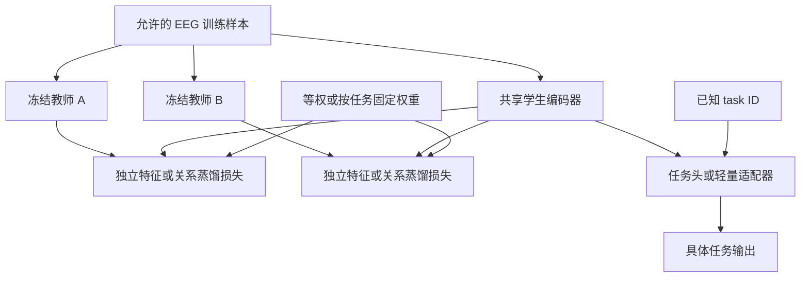

# 多教师蒸馏、任务路由与迁移方案

日期：2026-10-10。状态：文献与候选方案分析；没有实施、训练或下载权重。接续 M01–M12 和《赛前文献地图与模块替换计划》。

## 1. 结论：分类与加权解决不同问题

多教师蒸馏有对应的 EEG 论文，技术上可行；是否值得采用，需要证明比最佳单教师、同预算自监督预训练更有效。教师多不自动带来互补，也不自动减少训练成本。

建议把设计拆成两项：

- 任务路由：任务类型已知时，直接由官方任务 ID 选择任务头或适配器，不先训练一个任务分类器。
- 教师加权：在一个具体任务或通用预训练目标下，决定哪些教师适用、各贡献多少。

第一版采用共享学生编码器、独立任务头、两个教师、独立特征损失。先比较单教师与双教师等权，再比较按任务固定加权；只有收益稳定后再做逐样本软门控。

“任务”是我们要求模型回答的问题，不一定是 EEG 中可唯一识别的状态。同一记录可以同时用于质量判断和疾病筛查；睡眠 EEG 也可能含疾病信息。因此不能把七个赛道默认当七个互斥信号类别。

## 2. 对应论文及能支持的结论

使用 arXiv 主来源核对身份。以下数字若出现均为文献报告，没有本地复现证据。

| 优先级 | 论文 | 核心设计 | 对本项目的价值与证据边界 |
|---|---|---|---|
| P0 | [Standing on the Shoulders of Giants: Rethinking EEG Foundation Model Pretraining via Multi-Teacher Distillation](https://arxiv.org/abs/2603.04478v1)，Chenqi Li 等，2026-03-04 | MTDP：先学习多教师门控融合，再将融合表征蒸馏到 EEG 学生 | 最直接的 EEG 多教师预训练依据；已读摘要、方法与实验设置相关 HTML。论文用跨模态教师，不等于我们已经验证双 EEG 教师 |
| P0，理论基础 | [Distilling the Knowledge in a Neural Network](https://arxiv.org/abs/1503.02531v1)，2015 | 软目标、温度、集成知识压缩到单学生，以及通用模型与专家组合 | 解释多教师训练、单学生部署；摘要核验，类别语义一致时才适合融合概率 |
| P1 | [Adaptive Multi-Teacher Knowledge Distillation with Meta-Learning](https://arxiv.org/abs/2306.06634v1)，Hailin Zhang 等，2023 | MMKD：元权重网络适配教师组合，联合中间层与输出层知识 | 对应“如何加权”；摘要核验，[作者给出的代码](https://github.com/Rorozhl/MMKD)尚未检查。视觉证据不能直接证明 EEG 收益 |
| P1 | [Enhancing Low-Density EEG-Based Brain-Computer Interfaces with Similarity-Keeping Knowledge Distillation](https://arxiv.org/abs/2212.03329v1)，2022 | 高密度教师指导低密度学生，保持样本间相似关系 | 对应设备通道变化与关系蒸馏；摘要核验。需要训练时合法配对高/低密度视图，不是多教师通用基础模型 |
| P1 | [Pre-Training Graph Contrastive Masked Autoencoders are Strong Distillers for EEG](https://arxiv.org/abs/2411.19230v2)，2024 | EEG-DisGCMAE：图对比与掩码自监督、拓扑蒸馏、高低密度迁移 | 对应图原型和缺失电极；摘要核验，[作者给出的代码](https://github.com/weixinxu666/EEG_DisGCMAE)尚未检查 |
| P1，后续 | [EvoBrain: Continual Learning of EEG Foundation Models Across Heterogeneous BCI Tasks](https://arxiv.org/abs/2606.01767v2)，2026 | 谱任务归一化、响应关系蒸馏与重放，抑制跨任务遗忘 | 对应逐步接入任务模型；摘要核验，不是多教师融合方法，首轮不引入持续学习复杂性 |
| P1，优化参考 | [GradNorm](https://arxiv.org/abs/1711.02257v4)，2017/2018 | 用梯度尺度调节多任务损失权重 | 针对损失不平衡，不能当教师正确性的评估器；摘要核验 |
| P2，迁移分析参考 | [Taskonomy](https://arxiv.org/abs/1804.08328v1)，2018 | 学习任务之间的迁移关系 | 启发“教师×下游任务”迁移矩阵；视觉任务研究，不是 EEG 路由或蒸馏的直接证据 |

## 3. MTDP 的架构：最接近用户提出的路线

原论文使用 DINOv3 视觉教师和 Chronos-Bolt 时间序列教师，学生是 CBraMod 风格 EEG 模型。

1. 将 EEG 送入教师可接受的输入转换。视觉侧把 EEG 通道×时间矩阵作为图像，并做归一化与三通道复制；Chronos 独立处理各通道，再平均表示。
2. 第一阶段冻结教师，训练门控网络与预测头。门控根据教师特征输出 softmax 权重，用遮蔽潜在特征的去噪目标学习融合，不要求预先知道下游任务。
3. 第二阶段冻结门控，让随机初始化的 EEG 学生学习融合教师表征。投影头处理维度，使用余弦相似性目标。
4. 下游阶段移除教师、门控与蒸馏投影等训练组件，保留学生编码器并适配具体任务。

这支持“多种先验 -> 共享基础特征 -> 具体任务适配”，但没有证明必须先分类任务再提特征。原论文也没有证明门控权重能解释为真实任务类别概率。

复刻边界：原教师含大规模外部预训练知识；EEG 图像转换依赖通道顺序，min-max 可能削弱绝对幅度；Chronos 通道平均可能损失空间结构。我们不能直接照搬用于所有质量、疾病、相位敏感任务。原输入转换、归一化范围、权重版本、维度融合及数据协议仍要逐项登记后才能精确复刻。

第一轮更适合借用“先验证教师表征，再蒸馏单学生”的结构，用两个合法且能加载的 EEG 教师开展方法适配，不称为原 MTDP 的完整复现。

## 4. 推荐系统：训练时多教师，推理时单学生



学生特征不必硬分成“MI 特征”“睡眠特征”等互斥部分。共享编码器可同时保留多种信息，由不同任务头读取；任务适配器用于缓解需要时出现的冲突。只有实测表明共享不够，才引入独立专家或部分独立主干。

教师池先从两个可获得、获准且验证有价值的模型开始，例如 CBraMod 与 EEGPT。REVE/LUNA 是后续候选，需先核实获取、输入和资源。不能仅凭模型名称把一个指定为“纯空间”、另一个指定为“纯时间”；互补性要由同协议迁移与错误分析证明。

### 4.1 三类蒸馏分别使用

| 类型 | 何时可用 | 如何处理差异 | 首轮建议 |
|---|---|---|---|
| 特征蒸馏 | 教师没有共同分类标签，但都有可用 EEG 表征 | 同一时间窗分别按各教师协议处理；先用 pooled 特征，学生各投影头匹配各教师维度 | 首选，两个教师各自一项损失 |
| 关系蒸馏 | 特征维度/坐标系不同，希望保留样本关系 | 比较同一批合法配对样本的相似矩阵或结构，注意 batch 身份捷径 | 作为特征蒸馏之后的对照，不同时叠加 |
| 输出蒸馏 | 同一个任务、相同标签语义及类别映射 | 先适配并校准教师任务头，再做温度概率 KL；回归需另定义响应损失 | 具体任务适配阶段使用 |

睡眠五分类概率不能与 MI 四分类概率平均。两个特征向量即便同维度，语义基底也未必一致，不能未经对齐直接相加。单独匹配各教师的特征损失是第一版更容易审计的实现。

token 级蒸馏还需处理不同 patch 时长、通道集合与有效 mask；同一窗口并不意味着 token 一一对应。先做窗口级表征，确认有效后再研究 token 对齐。

### 4.2 目标函数的模块化设计

以下是项目设计示意，不是某篇论文的原公式：

```text
L = lambda_ssl * L_ssl
  + lambda_feat * sum_k alpha_k * D(P_k(z_student), stop_gradient(z_teacher_k))
  + lambda_sup * L_task
  + lambda_kd * sum_{k in eligible_task_teachers} beta_k * temperature^2 * KL(p_teacher_k || p_student)
```

教师冻结，P_k 是学生侧的独立投影；D 可先选择归一化特征的余弦距离。无标签预训练不使用监督任务项，没有适用且语义一致的任务教师时不使用输出 KL。alpha/beta 仅在适用教师集合内归一化。

保留自监督项是待检验的防退化候选，不预设必须与蒸馏混合。分别比较纯自监督、纯特征蒸馏、二者组合，不能把混合方案的全部增益归为多教师。

## 5. 分类还是加权：具体选择

| 情形 | 建议 | 理由 |
|---|---|---|
| 官方已给 task ID | 确定性路由任务头，不训练任务识别器 | 没必要再从 EEG 猜已知信息；避免路由错误传播 |
| 教师不适用于该任务或输入 | 先排除不适用教师 | 不让无意义的输出凭高置信度获得权重 |
| 多个教师都适用 | 先等权，再按任务固定权重 | 容易归因、资源少，也能检验加权是否必要 |
| 不同样本上教师质量明显变化 | 在固定权重基线上检验轻量软门控 | 保留互补信息，但需防门控塌缩与设备/数据集捷径 |
| 真正没有任务上下文的部署 | 独立研究任务适用性、拒识与软路由 | 任务未必互斥；需覆盖未知任务，不能强制七选一 |
| 推理预算极紧，必须选一个专家 | 比较硬路由与软路由成本和误差 | 硬分类可减少调用，但错误路由可能无法恢复；这与单学生部署是不同设计 |

softmax 置信度高不是教师可靠性的证明。先用训练范围内的校准集、验证任务表现、输入合法性与教师错误分析评估。固定权重可用验证集选择后冻结；学习型门控训练只用允许的训练数据，元学习需要内层划分。测试标签、逐例测试错误和排行榜不得给门控提供调参信号。

三种权重不能混淆：任务头路由权重、教师贡献权重、不同损失尺度权重。GradNorm 等方法处理优化尺度，不自动判断哪个教师更懂某个任务。

## 6. 映射回 M01–M12

| 模块 | 多教师新增准备 |
|---|---|
| M01 | 每阶段是否允许教师预训练权重、外部预训练知识、蒸馏、伪标签与教师缓存 |
| M02 | 教师选择、权重与门控的训练/验证范围；记录已有预训练语料与测试重叠 |
| M03 | 教师 checkpoint 来源、版本、许可、预训练语料、缓存谱系 |
| M04/05 | 同一原始窗口对应多个合法教师视图；采样、归一化、通道和 patch 差异 |
| M06 | 一个学生编码器、独立蒸馏投影、任务头；预先定义删除训练组件后的推理结构 |
| M07 | 特征/关系/输出蒸馏分开，权重、stop-gradient、mask 与坍塌诊断 |
| M08 | 顺序教师前向或缓存方案、存储估算、冻结 eval 模式、版本校验 |
| M09 | 下游任务头、可选适配器、同预算微调；无任务支持集时不训练被试专属模型 |
| M10 | 教师×任务迁移表；单教师/等权/固定权重/动态门控及负迁移消融 |
| M11 | 测量单学生部署、核对无教师依赖；蒸馏成本单列，不计成推理成本 |
| M12 | 区分 MTDP 原复现与 EEG 教师适配，列外部知识谱系与失败任务 |

公开教师蒸馏把公开预训练知识写入学生；学生随机初始化并不把该过程变成“没有外部知识”的训练。若正式决赛禁止这类知识，公开教师路线不可使用，应比较纯自监督，或在规则明确允许时使用仅在获准语料上从零训练的教师。这是赛规待核验项，不把海报的权重限制自行扩展成已确认禁令，也不视蒸馏为规避途径。

## 7. 最小验证顺序

| 阶段 | 内容 | 保持一致 | 继续条件 |
|---|---|---|---|
| T0 教师核验 | 单独加载、冻结线性探测，形成教师×任务表 | 被试 split、输入语义、任务头预算 | 教师本身有合法可复现表征；有互补收益的证据 |
| T1 单教师 | 学生自监督基线，A 蒸馏，B 蒸馏分别对照 | 同学生、语料、窗口、主指标与选择规则 | 至少单教师蒸馏能迁移，训练正确且资源可承受 |
| T2 双教师等权 | 同时施加 A/B 独立特征损失 | 蒸馏总权重归一化，不简单加倍损失强度 | 比最佳单教师有稳定增益，或达到明确资源目标 |
| T3 按任务固定加权 | 少量权重候选在验证集选择并冻结 | 相同支持集、预算与教师集合 | 相对等权有可解释增益，未造成关键任务退化 |
| T4 可选动态门控 | 小门控网络，与固定权重比较 | 数据范围、校准、教师输入和总预算 | 有逐样本互补证据，且门控收益超过额外复杂性 |
| T5 具体任务适配 | 线性头、部分解冻、全量或轻量适配器 | 匹配标签和训练预算 | 跨被试迁移收益；单学生推理通过协议 |

T2–T4 是独立对照，首轮不叠加关系损失、复杂元学习和专家主干。权重图可帮助诊断，但不能独立证明神经机制或可解释性。

资源方案先估算再测量：冻结教师不需要其反向图，仍占权重和前向激活。可以逐个教师提取并释放，或缓存合法训练窗口的表征；缓存大小按窗口数×教师数×特征维度×字节数估算，token 级缓存另计。缓存绑定数据/预处理/权重 hash，随机增强后不能误用旧特征。是否能在本机 8 GB 运行仍需实测。

将原 14 日准备计划的 D3–D4 加入 MTDP 方法卡，D7 加入蒸馏目标卡，D8 加入缓存/资源测量，D9–D10 加入教师迁移表和 T0–T5，D12 加入知识来源与阶段权限说明。以上现在只准备规范，不启动实验。

## 8. 目前可下的判断

“多教师 -> 一个共享学生 -> 具体任务迁移”有直接文献支撑，适合列为候选路线。优先使用已知任务路由加教师软加权；第一版先等权，后按任务固定加权。先做任务硬分类、再调用独立模型，只有任务未知或确有调用预算限制时才有必要。

尚待回答：公开教师在比赛各阶段是否允许；教师是否在我们的 split 上有互补性；小学生能否吸收知识而不损失关键任务；蒸馏的总计算/存储成本是否优于直接微调。没有这些证据，不承诺比赛增益或决定把多教师当唯一主线。

跨领域扩展：[跨领域时序参考与架构预案](跨领域时序参考与架构预案.md)加入 PatchTST、TS2Vec/MOMENT、Chronos-2、TimeMixer、Mamba、AM-RADIO 等参考，并按从零训练、公开权重、蒸馏、布局变化、长记录、在线、相位及任务未知建立八类预案。
