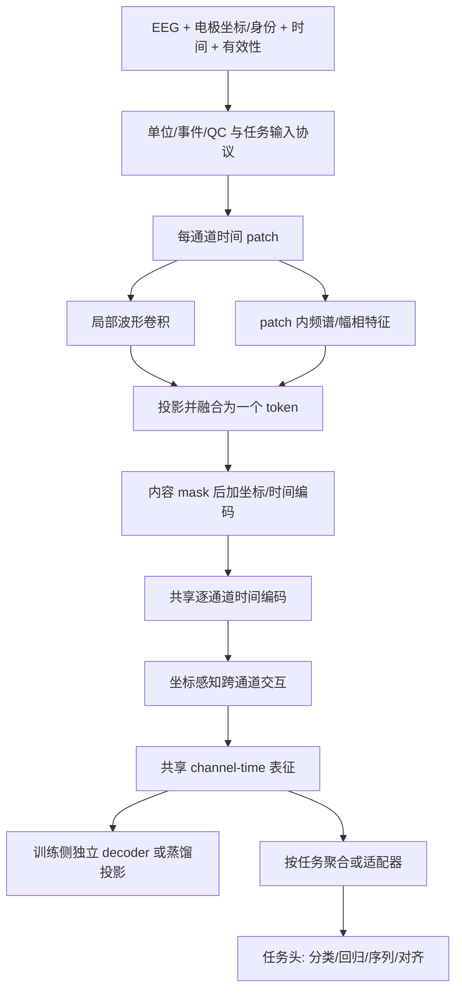

# 时序与 EEG 融合架构及赛前总预案

2026-10-11状态补充：已实现约4.91M候选、真实两任务69个完整研究运行及同一共享基座迁移；见reports/基础模型直接研发验收.md和联合预训练与共享基座规范.md。下文的几何偏置、长上下文、外部教师与未知任务路由仍为研究预案，不能当成已经实现的能力。

日期：2026-10-10。本文保留融合架构与分支的设计依据。后续用户已授权基础代码准备，当前已有六种编码器、训练/微调/蒸馏/评测闭环和合成工程检查；实现与限制以 [赛前代码底座与剪枝树](赛前代码底座与剪枝树.md) 为准。尚未验证真实 EEG 效果或确定比赛方案。

## 1. 主方案：融合什么，如何融合

建议主候选命名为 S0，采用“小型时频 patch + 坐标感知分解时空编码器”。通用时序模型贡献分片、共享时间编码和层次聚合；EEG 方法贡献波形/节律共存、物理电极空间关系、合法缺道处理、事件及标签单位。

不是把 PatchTST、iTransformer、CBraMod、Mamba 的完整模型串起来。只借用对应模块的思想，新建一个边界清楚的共享编码器。不同预训练目标、教师和任务头在外侧独立比较。

任务 ID 已知时直接选择任务头。教师在训练侧提供知识，部署只保留选定学生及任务组件。某个外部教师或目标有效，不要求替换整个共享编码器。

## 2. S0 的模块规格与张量接口

以下是待验证候选规格，不是已运行参数。D=192、4 个 block、每种 attention 4 个 head、MLP expansion=3 作为资源剖析起点；参数预算目标 2M–5M，实际参数量和显存必须在实现后核验。资源不足时选择单一更小规格 D=128，而不是留运行时兼容分支。

| 层 | 输入 -> 输出 | 具体设计 | 参考来源 / 不变量 |
|---|---|---|---|
| 输入 | `x[B,C,T]`，坐标/身份、时间、有效 mask | C/T 可变，单位统一；采样率、参考、任务窗口在输入协议冻结 | M05；不能把不同电极当数组前 C 路 |
| 分片 | `x -> patches[B,C,P,L]` | 初始比较 0.25/0.5 秒，尾部 pad 并记录每 patch 有效采样数 | PatchTST；不能为整除丢掉有效事件/样本 |
| 波形支路 | `patches -> w[B,C,P,Dw]` | patch 内一维卷积、非线性和局部池化；共享所有通道权重 | CBraMod/局部时序卷积；卷积不跨入其他 patch 的遮蔽内容 |
| 频谱支路 | `patches -> f[B,C,P,Df]` | patch 内固定窗 rFFT，幅度及可选实/虚部特征；线性投影 | CBraMod/TF-C；实虚部保留相位，低能量区需数值稳定 |
| 融合 | `[w;f;幅度摘要] -> e[B,C,P,D]` | concat 后单次投影；幅度摘要含合法局部 log-RMS 等，不先做复杂门控 | 保留不同物理信息；先无频谱 vs 有频谱消融 |
| 位置与 mask | `e -> h0[B,C,P,D]` | 有效目标内容替为 mask token 后，加电极坐标/身份和真实 patch 时间编码 | REVE/EEG；padding 与预训练 mask 分开 |
| 时间交互 | `h[B,C,P,D] -> ht` | 共享逐通道时间 self-attention，沿 P 轴计算 | PatchTST 时间思想；无效时间不参与 attention |
| 空间交互 | `ht -> hs` | 沿 C 轴 attention，加入坐标距离/几何偏置；与时间模块顺序组成 block | iTransformer/CBraMod/REVE；不是直接复刻其完整结构 |
| FFN/残差 | `hs -> h_next` | pre-norm residual + FFN，重复候选 4 个 block | 先稳定基础训练，不预先叠加新颖正则 |
| 聚合 | `h -> z[B,D]` 或序列表示 | 以有效 channel-time token 数归一化；任务需要时保留 P 或窗口维 | M06/M09；全无效输入按约定拒绝，不均匀填权重 |
| 任务头 | `z/sequence -> y` | 分类、连续回归、epoch 序列、时间对齐等分别设计 | 标签单位决定头，不用一个 flatten 分类头覆盖全部任务 |

候选 patch 长度是秒而非全局固定样本数，样本数由正式采样率确定；匹配公开权重则使用其原输入规格。共享输入采样率必须覆盖全部目标任务的有效频率，不能仅因 256 Hz 常见就当官方要求。

分解 attention 的主要注意力规模约为 `C*P^2 + P*C^2`，而全网格 attention 为 `(C*P)^2`。这是算量结构判断，省略投影等成本，不能直接当实测加速倍数。大型 C 或 P 时依然可能昂贵。

### 2.1 EEG 信息保真的三项约束

幅度：转换到固定物理单位，优先固定的训练集尺度缩放；不默认对每条测试记录做整段 min-max 或 z-score。若要使用样本内归一化，需要任务允许并保留/验证幅度摘要，不能靠摘要补救所有信息损失。

空间：信号、channel ID、坐标、mask 必须同步重排。真实坐标与模板估计位置分别标注；双极导联包含两个电极及差分方向，不按单点随意映射。无可靠坐标的数据进入预先选定的身份编码方案或排除/待确认表，不编造坐标。是否使用模板位置由任务与数据规范决定。

频谱/相位：0.5 秒 patch 的 FFT 频率间隔约 2 Hz，0.25 秒约 4 Hz，不能单靠这种短窗幅度谱区分所有邻近 SSVEP 频率。原波形分支始终保留时间信息；必要时在 SSVEP 任务层添加更长合法窗口的频率/相位表示，并对照经典频率解码方法。低功率频点的相位噪声需要明确处理。

## 3. 训练结构：每一轮只加一项

| 阶段 | S0 结构保持什么 | 可选训练目标 | 进入条件 |
|---|---|---|---|
| 监督正确性 | 输入/主干/任务头 | 有标签监督 scratch | 分组与标签正确；端到端基线及资源核验 |
| 自监督基准 | 同一输入与主干，加独立 decoder | 掩码波形重建，先随机 mask | 允许语料、有效目标计数、无分支偷看 masked 内容 |
| 掩码消融 | tokenizer、主干、目标不变 | 时间块/空间块/联合块，实际比例匹配 | 基准稳定；坐标尺度与块重叠有记录 |
| 目标消融 | tokenizer、主干、mask 不变 | 固定功率目标或 EMA 潜在目标分别对照 | 任务收益与信息保真；教师/EMA 成本可测 |
| 外部蒸馏 | 同一个学生，独立教师视图/投影 | 单教师、双教师等权、按任务固定加权 | 规则允许外部知识；教师表征有互补证据 |
| 下游适配 | 共享编码器，新增目标任务组件 | 冻结 probe/部分解冻/全量/适配器 | 匹配 split、支持集、指标与预算 |

外部多教师不必须与 EMA 自教师同时使用，也不必须加上波形、频谱、对比等全部损失。基础目标、蒸馏目标与组合另做对照，确保增益可归因。

## 4. 备选结构与启用条件

| 编号 | 触发情况 | 具体替代结构 | 怎么决定启用 | 不应做什么 |
|---|---|---|---|---|
| S1 低资源 | S0 超显存、吞吐不足，或注意力收益不足 | 共享 patch/局部卷积 + 轻量时间 mixer/TCN + 一层空间交互 + 相同任务头 | 同数据/指标的效果与 GPU 时间，峰值显存实测 | 只看参数量宣称更快；为部署保留无效旧路径 |
| S2 公共权重适配 | 允许预训练权重，标签/训练时间少 | 保持所选 EEG/MOMENT 教师原 tokenizer/主干，独立任务头或轻量适配器 | 冻结迁移、加载审计、输入适配与预算 | 强改 tokenizer 后继续称完整预训练迁移 |
| S3 跨领域蒸馏 | 允许外部知识，需小模型推理 | S0 或 S1 学生；EEG 教师 + 通用时序教师独立特征蒸馏 | 超过最佳单教师且资源可接受；必要时再视觉教师 | 一开始同时部署所有教师，或用无关标签输出混合 |
| S4 通道统一 | C/布局变化使固定空间模块失效 | 同 tokenizer，空间侧用坐标 cross-attention 映射 C->Q，时间侧保持 | 合法 montage/缺道测试、Q 与性能成本曲线、原通道 decoder | 将 Q 潜在通道假装成 C 电极接旧头 |
| S5 长记录离线 | P 太大，或任务必须使用跨 epoch 上下文 | S0/S1 短窗编码 -> epoch 特征 -> 先简单卷积/attention 聚合，必要时 SSM | 与无上下文版本比较；记录级评测和峰值资源 | 把整夜 raw token 直接扔进全 attention |
| S6 严格流式 | 要零未来信息与稳定增量成本 | 因果预处理 + 局部因果编码 + TCN/GRU 或已验证 SSM/xLSTM + 增量头 | 分块与批处理一致、延迟与 reset 正确 | 使用双向编码、整段归一化、零相位滤波后声称在线 |
| S7 任务未知 | 没有任务上下文且确需多用途自动判断 | 共享编码器 + 适用性/拒识 + 可兼容任务头；有证据才软专家 | 未知任务、混合标签、跨数据集验证 | 把所有赛道强制设成互斥分类，依据设备身份选头 |

S0 是建议优先评估的研究主候选，不是锁定比赛答案。S4–S6 是结构约束，可与选定训练主线组合。相位敏感不是额外堆一套主干，而是 S0/S1 等方案都要遵守的信息保真条件。

这些“后路”是科学备选方案，不是向后兼容实现。确定正式规格后只实现必要方案，淘汰的运行配置删除，文献/实验/失败证据保留。

## 5. 发生问题时的处置预案

| 问题 | 首先检查 | 合理后续动作 | 重验范围 |
|---|---|---|---|
| 官方规则迟到/修改 | 版本与影响的阶段，数据/教师/权重权限 | 未确认分支暂不执行，继续独立文献和接口准备 | 规则矩阵、受影响语料/检查点与实验合法性 |
| 数据损坏/许可不明 | 来源、版本、完整性、许可 | 隔离，登记缺口；替代数据须另立角色并确认权限 | manifest、split、数据卡及受影响缓存 |
| 无法识别单位/事件/电极 | 原采集说明和元数据 | 暂不进入训练；不猜测，明确所需信息 | 读取、单位转换、标签/坐标、衍生数据 |
| 划分泄漏或高分异常 | subject/session/trial、重复、刺激/先验 | 先修正并失效相关结论，再重建对照 | split、预处理拟合、训练、评测 |
| 缺道/变长失败 | 三类 mask、attention、pooling、C/T 对应 | 先修正契约；必要时独立比较 S4 | 单位输入、mask、decoder、缺道与布局评测 |
| OOM/训练过慢 | token 数、激活、教师同时驻留、batch、AMP | 明确缩小单一规格；比较 S1 或分层 S5；教师顺序/缓存另算 | 资源、有效 batch、训练公平性及指标 |
| Mamba/xLSTM 内核不可用 | 本机系统与库官方支持、真实依赖 | 在该场景选择已核验 TCN/GRU/attention 预案；不安装整套环境赌兼容 | 结构/资源与同协议表现，不声称已复现原核性能 |
| 教师没有收益 | 教师冻结 probe、输入语义、表征层/标签适用性 | 去掉无价值教师，比较单教师或纯自监督 | 教师×任务表、学生消融与知识来源 |
| 多教师冲突 | 梯度/特征尺度、最佳单教师、适用域 | 等权总强度归一化；按任务固定权重；仍无益则不合并 | 配对任务指标、关键任务退化、资源 |
| JEPA/蒸馏表征退化 | stop-gradient、EMA、投影、方差/谱、偏置增大 | 暂停受影响运行，保存诊断；回到已验证目标重新比较 | 表征、冻结迁移、loss 归一化与训练记录 |
| 相位/幅度任务受损 | 归一化、降采样、频谱目标、patch/window | 改为保真输入/波形目标或任务侧更长频率窗口 | 预处理、目标消融、SSVEP/ERP/QC 指标 |
| 恢复后偏差/NaN | 优化器、scheduler、scaler、RNG、采样器状态 | 校验最近完整 checkpoint，按记录恢复或新立偏差运行 | checkpoint hash、续训一致性、数值诊断 |
| 提交环境失败 | 官方 I/O、版本、文件顺序、依赖、预处理 | 修正打包/接口，使用已冻结合法候选重新演练 | 干净环境加载、预测一致性、时间和输出格式 |

预案完成不意味着这些问题已经解决。实际修复必须留下具体日志与重验记录；不把换一个模型当修复数据/评测错误。

## 6. 模块负责人和赛前交付包

按既有 M01–M12，最小两人分工：A 负责规则、数据、评测和来源记录，B 负责架构、目标、训练设计和适配；交叉审阅。三人团队可由 C 负责运行/资源/提交/报告协调，不需要十二人或新建外部聊天。

| 交付包 | 对应模块 | 内容与完成条件 |
|---|---|---|
| 规则/目标包 | M01/02 | 官方来源矩阵、split/指标/聚合、权重/蒸馏权限、未知项；尚无官方文件的条目不能标通过 |
| 数据/输入包 | M03/04/05 | 许可/版本/单位/事件/坐标/被试，最小样例获取计划，预处理与 mask 契约 |
| 文献/架构包 | M06/07 | 核心原文/代码卡，S0 图与形状，S1–S7 触发条件，目标及信息保真说明 |
| 资源/运行包 | M08 | 实际环境记录、测量表、时间/存储估算、checkpoint/恢复与停止规范；执行验收待后续 |
| 适配/选择包 | M09/10 | scratch/传统/EEGNet，单模块消融、教师×任务、固定 seed/预算与验证选择规则 |
| 推理/报告包 | M11/12 | 官方 I/O、状态边界、单学生部署、打包演练与证据表，Proposal/PPT/预算框架 |

时间安排仍使用 14 个工作日准备计划。D1–D2 规则/评测；D3–D4 重点论文；D5–D8 数据/融合接口/目标/资源；D9–D10 适配与实验矩阵；D11–D14 提交契约、报告和交叉审阅。它是相对计划，正式赛程与可用工时确认后再排实际日期。

### 6.1 精读顺序，不一次复刻全部论文

1. OmniEEG-Bench 与正式协议：先理解要证明什么。
2. PatchTST + CBraMod + REVE：冻结 S0 的分片、时频与空间模块。
3. TS2Vec/MOMENT + 掩码几何/SpecBraM：准备自监督目标及其任务边界。
4. MTDP + AM-RADIO：多教师融合与单学生设计；再核验具体教师。
5. LUNA、TimeMixer、Mamba/TiRex-2：只精读被数据/资源触发的备选模块。

一张复现卡需要身份、完整原协议、代码/版本/许可、目标表格、输入、权重语料、成本和差异。缩小模型/新融合属于方法适配，不能称为上述论文的精确复刻。

## 7. 开始执行的条件与尚未完成的准备

执行前的最低条件：官方允许范围可查；代表任务、分组和主指标冻结；样本/标签/单位/电极真实；一个主规格与一个资源备选明确；baseline、候选对照、预算及停止条件写入启动单。教师路线还需权重许可、来源谱系、可用输入及单教师收益验证。

目前已有模块代码和合成恢复/因果/接口检查。尚缺正式赛规与 starting kit、部分论文全文和官方代码审计、真实数据准入、实际数据与尺寸的显存/吞吐、优化流式缓存及官方提交演练；不能把小模型合成检查视为这些项目已经完成。

本轮以 S0 和它的低资源 S1 完成准备主线；公开权重/多教师 S2/S3 保持按规则启用；S4–S7 按真实场景进入。先证明一个小模型端到端有效，再用证据决定增加哪些能力。

## 8. 资料入口

- [M01–M12 全流程设计](OmniEEG基础模型全流程设计.md)：原模块拆分、资产与代码风险。
- [赛前文献地图与计划](赛前文献地图与模块替换计划.md)：EEG 主要/近期论文、阅读深度、替换条件和 14 日表。
- [跨领域时序与八类场景](跨领域时序参考与架构预案.md)：已核对编号的通用时序/视觉论文与信息边界。
- [多教师蒸馏与任务迁移](多教师蒸馏与任务迁移方案.md)：MTDP 方法、分类/加权、蒸馏接口与 T0–T5 对照。
- [赛前准备流程规范](赛前准备流程规范.md)与[记录模板](赛前准备记录模板.md)：各阶段产物、异常、重验及证据记录。
