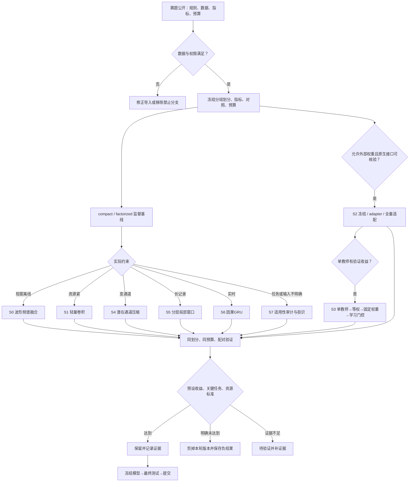

# 赛前代码底座与剪枝树

当前已从纯合成工程准备进入用户授权的真实数据小规模检查。MI 与睡眠各三名被试闭环见 [真实数据验收](../reports/运动想象与睡眠真实数据闭环验收.md)。合成结果仅证明执行能力；单种子、单验证被试检查也不足以建立基础模型或比赛效果结论。

2026-10-10 用户提供的公告明确：复赛使用官方 EEG 基座微调，决赛从零预训练并禁止公开权重。下图的外部权重/教师分支不能默认进入决赛；官方基座原生适配也尚未实现。七赛道覆盖和下一步真实数据检查见 [赛事公告与验证计划](赛事公告与赛前真实数据验证计划.md)。

## 1. 可执行决策树



剪掉的是某版本和预算下的候选，不能宣布一类方法永远无效。最终测试和排行榜不进入剪枝工具；开发反馈单独记账。

## 2. 模块与接口

| 文件 | 责任 |
|---|---|
| `data.py` | Sample/Batch、NPZ 账本、grouped split、哈希与泄漏审计、补齐、train-only 统计 |
| `model.py` | patch、位置、六种编码器、独立任务与预训练头 |
| `objectives.py` | 掩码、波形/频谱/频带、EMA、对比、多教师投影、语义一致的 KL |
| `engine.py` | 训练、迁移、验证选择、恢复、预测、证据记录 |
| `fewshot.py` | train 内按类别抽完整试次，query/test 不变 |
| `stream.py` | 完整 patch 的因果输出和记录边界 reset；当前重算前缀 |
| `metrics.py` | 分类/回归、主体汇总、置信度拒识基础函数 |
| `profile.py` | 当前批次推理时间与 CUDA 已分配内存峰值 |
| `decision.py` | pending/retain/prune，配对主体 bootstrap 与保护任务 |
| `cli.py` | 总入口；缺失的官方适配器直接报错 |

共同输出：`tokens[B,C,P,D]`、`features[B,D]`、窗口与序列 logits、波形重建、频带预测。实际通道必须有真实词表 ID 或坐标，不能把数组下标当电极身份。掩码替换内容之后加入位置。

三类掩码分开：样本右侧补齐、token 有效性、自监督内容掩码。尾部 patch 保留真实样本，波形损失排除补齐，频谱目标只计完整 patch。有效通道内部缺测段由导入器分段或明确处理，不能伪装成右侧补齐。

## 3. 架构替换表

| 配置值 | 实现 | 首个对照与限制 |
|---|---|---|
| `compact` | raw patch、深度卷积、同刻跨通道上下文 | 最小监督基线；不是 EEGNet 复刻 |
| `factorized` | 每通道时间注意力、每时刻通道注意力、FFN | 纯波形主干，作为融合对照 |
| `fusion` | raw + patch 内卷积 + rFFT 幅值投影，时空主干 | 去频谱/去卷积消融；不是 CBraMod 复刻 |
| `latent` | C→Q 潜在通道→主干→原通道查询取回 | Q、缺通道、延迟对照；不是 LUNA 复刻 |
| `hierarchical` | 局部时空主干、块摘要 GRU、块上下文广播 | 长序列候选；块内含未来，不能严格在线 |
| `causal` | 完整 raw patch、单向每通道 GRU、同刻通道汇总 | patch 结束时刻输出，patch 长度带来等待延迟 |

支持窗口分类/回归与 patch 序列分类/回归，分别为 `classification/regression/sequence_classification/sequence_regression`。当前没有自由长度预测、自回归生成或自动未知任务识别。已知任务明确选 head，迁移时初始化同一个 encoder 并新建任务头。

## 4. 数据契约

先按受试者/会话/试次分组，再切窗。每个数值 NPZ：

| 字段 | 形状 | 要求 |
|---|---|---|
| x | C,T | 有限浮点，伏特，已完成明确记录的预处理 |
| channel_ids | C | 当前账本词表整数；跨数据集共享检查点必须先统一真实通道词表；未知 -1 时必须有真实坐标 |
| coords | C,3 | 米；账本注明坐标系 |
| coord_valid | C | 布尔；坐标是否已知 |
| target | 可选 | 窗口类标整数标量；回归 O；序列类标 P；序列回归 P,O |

序列标签与 patch 结束时刻对齐；分类缺标签 -100，序列回归缺标签 NaN，只用于目标。改变 patch_samples 要重新生成序列目标。合成序列生成器固定诊断用 32 样本 patch。

JSON 顶层包含 sample_rate、unit=volt、coordinate_unit=meter、coordinate_frame、channel_vocabulary、use_status、group_by、samples。分类有有序 labels；回归有 target_schema.names/unit。每条样本含 path、sha256、sample_id、dataset、subject、session、trial、split。真实数据许可核验后才填 approved，这不是脚本授予的许可。

文件/波形哈希查精确重复，组元数据查切窗亲缘。重新裁切/重采样后的近重复还要靠原始记录身份与导入审计。归一化只由 train 拟合；迁移沿用源模型统计。初始化与教师接入均检查其完整上游训练组/波形；检查点累计来源暴露，评测检查该并集。验证选择来源不能接触保留测试组。来源分组口径不一致时拒绝接入。

EDF/MAT 读取、滤波、参考、重采样、事件对齐应按赛题实现；本阶段不自动猜测。模型因果检查不代替预处理的未来信息审计。

## 5. 训练、迁移与多教师

`scripts/prepare_configs.py` 生成 configs/recipes 中的可执行小模型配方。

| 配方 | objective / tuning | 验证重点 |
|---|---|---|
| 监督基线 | supervised/full | 无预训练基线 |
| 掩码预训练 | masked/full | raw MSE，可加完整 patch 的频谱/频带目标 |
| EMA 预训练 | ema/full | 掩码学生对齐完整输入 EMA，无教师梯度 |
| 对比预训练 | contrastive/full | 增益/噪声两视图，batch 对比；主体负样本偏差要审计 |
| 全量微调 | supervised/full + initialize | 与从头训练配对 |
| 线性探测 | supervised/linear + initialize | head 可训练，encoder/dropout 冻结 |
| 残差 adapter | supervised/adapter + initialize | adapter + head 可训练；不是 LoRA |
| 少样本 | fewshot 再训练 | 完整 train 试次抽样，多种子，query 不变 |
| 单/多教师 | distill/full | 教师冻结、源归一化、独立投影、cosine loss |

频带由 model.bands 定义；FFT 分辨率 fs/patch_samples。频带没有 bin 直接报错，不假造可分辨特征。近邻 SSVEP 频率需要更长观察窗或任务模型。

多教师论证顺序：无蒸馏→分别单教师→等权→任务固定权重→学习门控。特征不直接平均；学生分别投影到各教师维度，再加权 normalized cosine loss。学习门控有熵约束，但不能据此保证有效。

当前训练器接本项目教师检查点，允许不同特征维度，但要求相同采样率/词表/坐标系。外部 EEGPT/Chronos/CBraMod 需真实原生输入视图适配器，不能随意改权重名称。输出 KL 只允许同任务同有序标签，不同任务仅考虑经验证的特征迁移。

```powershell
py -3.12 -X utf8 scripts/prepare_distillation.py --student-config configs/fusion_supervised.json --teachers experiments/outputs/teacher-a/best.pt experiments/outputs/teacher-b/best.pt --weights 1 1 --provenance "填写教师数据、训练目标和源码版本" --overlap "填写下游主体及记录的重叠审计" --use-status approved --output configs/my-distill.json
```

教师配置保存权重哈希、来源、许可、重叠声明。脚本默认 pending；核验后才设 approved。只有一个教师可作为单教师对照，weights 可作为固定权重，learned 可启用门控。

## 6. 恢复、评测与资源

README 给出启动命令。train 的 initialize 为新实验 encoder 迁移，resume 为同实验 last.pt 恢复，不可同时使用。新运行必须空目录，不能覆盖证据。fewshot 的 trials-per-class 是每类试次数，不能把窗口数当样本预算。

恢复只在 epoch 边界：同源码、同数据、同配置，仅可延长 epochs。保存 model、optimizer、EMA、蒸馏投影/门控、Python/NumPy/torch/CUDA RNG 与采样器 generator。当前 FP32，无 scheduler/scaler，不声称已恢复不存在的组件。预算或非有限值停止，保留最后完整 epoch，不承诺 batch 中途等价恢复。

best.pt 只由 validation 选择。预训练默认验证 loss；监督可选主体平均 balanced_accuracy/MSE，并明确方向。序列预测保存 patch_index，当前指标按 patch，再主体平均；实际试次、事件、睡眠 epoch 或官方评分需要按赛题实现聚合。

保存 config.json、environment.json、epochs.jsonl、best/last.pt；评测保存 metrics.json、predictions.jsonl；最终测试访问追加 test_access.jsonl。只加载本地可信训练检查点，完整 RNG 恢复使用 Python 对象序列化。

```powershell
py -3.12 -X utf8 -m eeg_mime_foundation.cli profile --config configs/fusion_supervised.json --manifest data/processed/diagnostic/manifest.json --device cuda --output experiments/outputs/resource.json
```

profile 仅测当前尺寸的 FP32 全头诊断批次，CUDA 值为已分配内存，不含驱动/其他进程/多教师/EMA；CPU 内存值为空。不能用小批次宣称大通道长序列能训练。stream 当前重算完整前缀，因果性已验证，常量内存与低延迟仍需优化后测量。

## 7. 剪枝证据与方法论证

从 decision_pending.json 开始。真实验证前保持 pending，每个候选填：

- source=validation、real_data=true、protocol_id、frozen_before_runs=true。
- direction、min_gain、max_guard_regression：实际任务中预先确定。
- paired：subject、seed、baseline、candidate；同主体同种子配对，主体内种子均值后做主体 bootstrap。
- guards：任务名→baseline/candidate/direction，工具实算回退。
- rules_allowed/rule_source；resource_measured/resource/limits：有来源或实测才硬剪枝。

区间下界超过收益门槛 retain，上界不超过门槛 prune，否则 pending。两个主体可运行工具但不能保证统计可靠；真实样本量与多重比较另行约束，不把重叠窗口当独立样本。

| 问题 | 最小对照 | 补充证据 |
|---|---|---|
| 融合 | compact、factorized、fusion | 相同 split/预算，频谱与卷积消融 |
| 预训练 | scratch、linear、adapter、full | 固定 support/query，预训练重叠 |
| 多教师 | best single、equal、fixed、learned | 权重分布、互补性、关键任务退步 |
| 潜在通道 | 原通道、不同 Q | 缺通道、主体指标、显存与延迟 |
| 分层 | 短窗口、长全局、hierarchical | 边界标签、聚合、长记录需求 |
| 因果 | 离线、causal | 滤波未来信息、patch 等待、reset、流式资源 |

## 8. 开赛后的执行顺序

1. 核验官方目标、指标、许可、外部权重、延迟与提交接口，保存版本。
2. 实现原始读取和标签构造，冻结 grouped manifest 与预处理；先不改模型。
3. compact/factorized + 官方指标跑通，加入相应领域基线，排查泄漏与异常分数。
4. 根据约束启用分支，逐模块增加能力；外部接口核验后才接 S2/S3。
5. 配对验证与剪枝，保留负结果，避免所有模块一次启用造成无法归因。
6. 冻结选择结果，再最终评测、提交格式验证和故障处理。

赛前完成接口与组合验证；官方标签/指标、真实数据适配、权重许可、真实效果和部署结论在题目公开后补齐。
